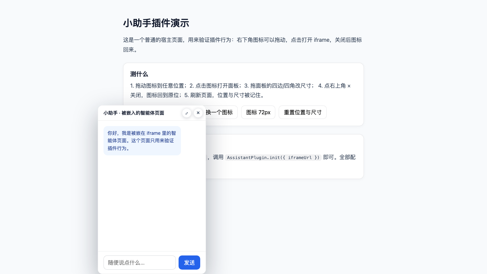

# AssistantPlugin · 网页小助手浮窗插件

把智能体页面以「悬浮图标 + 可拖拽面板」的方式嵌进任何网站。零依赖、单文件、Shadow DOM 隔离样式，引入一行 `<script>` 即可使用。



## 特性

- **悬浮图标**：支持图片或内联 SVG，尺寸可配置，运行期可替换
- **可拖动**：图标随意拖，位置自动夹在视口内
- **点击打开**：在图标位置展开 iframe 面板，iframe 懒加载
- **八向缩放**：面板四边、四角都能拖拽拉伸，带最小尺寸限制
- **可移动面板**：拖标题栏或顶部拖动区移动整个面板
- **一键放大**：右上角按钮或双击标题栏铺满视口，再点还原
- **关闭复位**：关闭面板后图标回到原位置，iframe 不销毁，会话不中断
- **状态记忆**：位置、尺寸、开关状态写入 localStorage，可按实例隔离
- **样式隔离**：Shadow DOM，既不污染宿主页面，也不被宿主 CSS 影响
- **小窗口适配**：最小尺寸随视口收缩，窗口缩放时面板自动夹回视口

## 快速开始

```html
<script src="https://gitee.com/mercerTTT/assisant-plugin/raw/main/src/assistant-plugin.js"></script>
<script>
  AssistantPlugin.init({
    iframeUrl: 'https://your-agent.example.com',
    iconUrl: '/assistant-icon.png',
    iconSize: 56,
    width: 420,
    height: 640
  })
</script>
```

也可以把 `src/assistant-plugin.js` 下载到自己的静态目录，或经 npm / 打包工具引入：

```bash
npm install git+https://gitee.com/mercerTTT/assisant-plugin.git#main
```

```js
import AssistantPlugin from 'assistant-plugin'

AssistantPlugin.init({ iframeUrl: 'https://your-agent.example.com' })
```

## 配置项

| 字段 | 类型 | 默认值 | 说明 |
|---|---|---|---|
| `iframeUrl` | string | —（必填） | 要嵌入的智能体页面地址 |
| `iconUrl` | string | `''` | 图标图片地址 |
| `iconHtml` | string | `''` | 图标内联 SVG/HTML，优先级高于 `iconUrl` |
| `iconSize` | number | `56` | 图标直径，单位 px |
| `iconAlt` | string | `打开小助手` | 图标的 aria-label / tooltip |
| `title` | string | `小助手` | 面板标题（`header: true` 时显示） |
| `header` | boolean | `false` | 是否显示顶部标题条；关闭时右上角保留浮动按钮，顶部 8–18px 为拖动区（最上 8px 与左右 14px 留给缩放） |
| `width` / `height` | number | `420` / `640` | 面板初始尺寸 |
| `minWidth` / `minHeight` | number | `320` / `420` | 面板最小尺寸（视口更小时自动下调） |
| `position` | string | `bottom-right` | 初始位置：`bottom-right` / `bottom-left` / `top-right` / `top-left` |
| `offset` | number | `24` | 初始位置距视口边缘的距离 |
| `zIndex` | number | `2147483000` | 整体层级 |
| `remember` | boolean | `true` | 是否记忆位置 / 尺寸 / 开关状态 |
| `storageKey` | string | `assistant-plugin` | localStorage 键名，同页多实例必须分开 |
| `lazy` | boolean | `true` | 首次打开才加载 iframe |
| `sandbox` | string | `''` | 传给 iframe 的 sandbox 值，留空表示不加限制 |
| `onOpen` / `onClose` | function | `null` | 打开 / 关闭回调 |

## 实例方法

```js
const plugin = AssistantPlugin.init({ iframeUrl: 'https://agent.example.com' })

plugin.open()             // 打开面板
plugin.close()            // 关闭面板
plugin.toggle()           // 切换开关
plugin.isOpen()           // 是否打开
plugin.toggleMaximize()   // 放大 / 还原
plugin.isMaximized()      // 是否处于放大状态
plugin.setIcon({ iconUrl: '/new-icon.png' })   // 运行期换图标（也可传 iconHtml）
plugin.setSize(72)        // 运行期改图标尺寸
plugin.destroy()          // 移除插件并解绑事件
```

## 行为说明

- **点击 vs 拖动**：指针按下后移动超过 5px 判定为拖动，否则视为点击打开面板。
- **拖动边界**：图标与面板都被限制在视口内，窗口缩放时重新夹紧。
- **面板定位**：首次打开时贴着图标展开，右侧或下方空间不足会自动翻到另一侧。
- **拖动区与缩放区**：无标题条模式下，面板最上方 8px 与左右 14px 是缩放热区，8–18px 是拖动区（悬停出现小横杠提示）。
- **缩放规则**：四边单方向拉伸，四角双向拉伸；宽高不小于最小尺寸，也不超出视口。
- **关闭行为**：关闭只隐藏面板，不销毁 iframe，再次打开保持原页面状态。
- **Esc**：面板打开时按 Esc 关闭。
- **多个实例**：同一页面需要多个浮窗时，给每个实例传不同的 `storageKey`。

## 浏览器兼容

| 浏览器 | 版本 |
|---|---|
| Chrome / Edge | 90+ |
| Firefox | 90+ |
| Safari | 15+ |

依赖 Pointer Events、Shadow DOM、CSS 自定义属性，均为现代浏览器标准能力；不依赖任何系统 API，Windows / macOS / Linux 表现一致。

## 本地演示

```bash
cd assistant-plugin
python3 -m http.server 8090      # Windows: python -m http.server 8090
```

- 演示页：<http://localhost:8090/demo/>
- 自测页：<http://localhost:8090/demo/selftest.html>

自测页会跑 16 条断言（初始化、开关、放大还原、图标替换、尺寸、持久化），结果以表格打印在页面上，汇总写入 `window.__selftest`：

```js
{ total: 16, passed: 16, failed: 0, results: [...] }
```

## 目录结构

```
assistant-plugin/
├── src/assistant-plugin.js   # 插件本体（单文件、零依赖）
├── demo/index.html           # 演示宿主页
├── demo/agent.html           # 被嵌入的示例智能体页
├── demo/selftest.html        # 浏览器内断言自测
├── screenshots/              # 文档截图
├── README.md
├── CHANGELOG.md
├── CONTRIBUTING.md
├── LICENSE
└── package.json
```

## 常见问题

**页面空白 / 面板里不显示内容？**
被嵌入站点若设置了 `X-Frame-Options: DENY` 或 CSP `frame-ancestors`，浏览器会拒绝加载，需要对方站点放行。

**能和 iframe 里的页面通信吗？**
跨域时插件读不到 iframe 内部内容，请在页面里用 `postMessage` 自行约定消息格式，插件不做封装。

**为什么默认不显示标题条？**
大多数智能体页面自带标题，再加一层标题会重复。需要标题条时传 `header: true`。

**位置 / 尺寸记忆怎么清掉？**
`localStorage.removeItem(storageKey)`，或初始化时传 `remember: false`。

**可以在同页放两个浮窗吗？**
可以，给每个实例不同的 `storageKey`，否则位置状态会互相覆盖。

## 版本

当前版本 `0.1.0`，变更记录见 [CHANGELOG.md](CHANGELOG.md)。

## 贡献

见 [CONTRIBUTING.md](CONTRIBUTING.md)。提交前请跑一遍 `demo/selftest.html`。

## 许可证

[MIT](LICENSE) © 2026 mercer (mercerTang)
